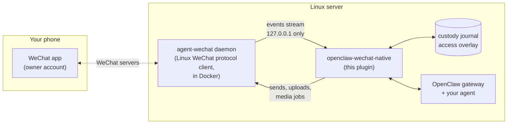

# openclaw-wechat-native

**An OpenClaw channel plugin for personal WeChat that runs natively on Linux.** It connects your OpenClaw agent to WeChat through a local daemon. There is no Windows VM, no Wine, no phone emulator and no cloud relay. It works with accounts that Tencent's official iLink plugin refuses, including North American accounts.

Your agent can chat in private messages and in groups, the same way it does on Discord or WhatsApp. It can read photos, files, voice notes and stickers, and it can reply with text, images, video and natural-sounding voice notes.

> **Unofficial project.** This plugin is not affiliated with Tencent, WeChat or OpenClaw. Automating a personal WeChat account may break WeChat's terms of service and can get the account restricted. Use an account you can afford to lose, keep the volume human, and read [Security and privacy](#security-and-privacy) before you start.

---

## Contents

- [Features](#features)
- [How it works](#how-it-works)
- [Requirements](#requirements)
- [Installation](#installation)
- [Configuration](#configuration)
- [Owner commands in WeChat](#owner-commands-in-wechat)
- [Media handling](#media-handling)
- [Reliability: no lost or duplicated messages](#reliability-no-lost-or-duplicated-messages)
- [Security and privacy](#security-and-privacy)
- [Known limitations](#known-limitations)
- [Troubleshooting](#troubleshooting)
- [Development](#development)
- [Credits and license](#credits-and-license)

---

## Features

| | |
|---|---|
| **Private chats** | Replies to people on an allow list. Everyone else is ignored silently. |
| **Group chats** | Only in groups you enable, and only when someone **@-mentions** the bot or **quote-replies** one of its messages. Everyone in an enabled group can talk to it. Each sender is attributed by name, so the agent knows who said what. |
| **Images and files** | Photos, PDFs and other attachments are downloaded, checked, and given to the agent as real files it can open. |
| **Voice notes in** | Voice notes are transcribed, and the agent gets both the transcript and the audio. |
| **Voice notes out** | The agent can answer with a native WeChat voice bubble in SILK format, generated by any OpenClaw TTS provider. ElevenLabs works well, including in Chinese. |
| **Stickers and GIFs** | Animated stickers become a frame grid, so vision models see the whole animation and not just a blank first frame. |
| **Image plus caption** | A photo and the text sent right after it are merged into **one** turn, so the agent answers once. |
| **Outbound media** | The agent can send images, video and voice notes, not only text. |
| **Owner commands** | Manage access from WeChat itself: `@Bot allow @Person`, `@Bot enable this group`, `who's allowed`, and more. No config edits or restarts are needed. |
| **Restart-safe** | A durable custody journal means no message is lost or answered twice across crashes, reboots and gateway restarts. |
| **Private by default** | The diagnostics log contains counts and error classes only, never message text or contact names. The daemon is only reachable on loopback. |

## How it works



1. The **[agent-wechat](https://github.com/thisnick/agent-wechat)** daemon logs in as a *linked Linux device* on the bot's WeChat account, the same way WeChat for Linux or Mac does. You scan a QR code once. It exposes a small HTTP API on `127.0.0.1`.
2. **This plugin** streams events from the daemon and decides what to keep:
   - it drops anything not on the allow list;
   - in groups, it requires an @-mention or a quote-reply;
   - it merges a photo with its caption.

   It then hands each message to OpenClaw as a normal inbound turn, with the media attached.
3. The agent's replies go back through OpenClaw's outbound pipeline. The plugin turns them into daemon sends (text, image, video, or SILK voice) and records each one in the journal before and after sending.

The plugin is plain Node.js with no runtime dependencies beyond OpenClaw itself. Animated stickers also need `ffmpeg`.

## Requirements

- **Linux** on x86-64. Tested on Ubuntu 24.04.
- **Node.js 22 or newer**
- **OpenClaw 2026.9.8 or newer**, with the gateway running as a service.
- **Docker**, to run the daemon.
- **ffmpeg**, to turn animated stickers into frame grids. Optional; without it, stickers fall back to their first frame.
- A **WeChat account for the bot**, plus your own account as the owner.
- Optional: an OpenClaw **TTS provider** for outgoing voice notes, such as ElevenLabs or OpenAI.

## Installation

> One-line installers (`npm`, Homebrew, `curl | sh`) are planned. Until they ship, installation is manual.

### 1. Run the daemon

Build or pull [agent-wechat](https://github.com/thisnick/agent-wechat), following its README, and run it so that its API listens on **loopback only**. For example, publish it as `127.0.0.1:6174:6174`; never use `0.0.0.0`. Log in by scanning the QR code with the bot account, then create an API token for this plugin and save it to a file only you can read:

```sh
install -m 600 /dev/null ~/.openclaw/wechat-native/token
$EDITOR ~/.openclaw/wechat-native/token   # paste the daemon token, save
```

> **Voice notes:** daemon builds up to at least `v1.0.0-beta.13` send voice notes with the wrong format flag, so receivers hear noise. This is [agent-wechat#277](https://github.com/thisnick/agent-wechat/issues/277). Use a build that includes the fix, or apply it yourself: `VoiceFormat=4` (SILK) and `CancelFlag=0` in the voice upload request.

### 2. Install the plugin

```sh
git clone https://github.com/alexdeg92/openclaw-wechat-native.git
cd openclaw-wechat-native
npm install
npm run build
npm test          # optional: 170 tests, about 1 minute
```

### 3. Tell OpenClaw about it

Add the plugin path and the channel to `~/.openclaw/openclaw.json`. See [Configuration](#configuration) for every field. **Stop the gateway before you edit the config** (`openclaw daemon stop`), then start it again (`openclaw daemon start`). If you edit while it's running, the live reload may leave the channel stuck.

```json5
{
  plugins: {
    load: { paths: ["/path/to/openclaw-wechat-native"] },
    allow: ["wechat-native-isolated"],
    entries: { "wechat-native-isolated": { enabled: true } }
  },
  secrets: {
    providers: {
      "wechat-native-isolated": { source: "file", path: "~/.openclaw/wechat-native/token", mode: "singleValue" }
    }
  },
  channels: {
    "wechat-native-isolated": {
      accounts: {
        main: {
          enabled: true,
          baseUrl: "http://127.0.0.1:6174/",
          daemonAccountId: "account-1234567890",
          selfId: "wxid_bot000000000",
          ownerIds: ["wxid_owner0000000"],
          allowFrom: ["wxid_owner0000000"],
          verifiedPeer: "wxid_owner0000000",
          dmPolicy: "allowlist",
          groupPolicy: "allowlist",
          groups: { "1234567890@chatroom": { requireMention: true } },
          token: { source: "file", provider: "wechat-native-isolated", id: "value" },
          journalDir: "~/.openclaw/wechat-native/journal",
          startAfter: "0"
        }
      }
    }
  }
}
```

Send the bot a private message from the owner account. It should answer within a few seconds.

## Configuration

All fields live under `channels["wechat-native-isolated"].accounts.<name>`.

| Field | Required | Description |
|---|---|---|
| `enabled` | ✅ | `true` to run this account. |
| `baseUrl` | ✅ | Daemon API base. It **must** be `http://127.0.0.1:<port>/`; any other host is rejected. |
| `daemonAccountId` | ✅ | The daemon's account ID for the bot login. |
| `selfId` | ✅ | The bot's own WeChat ID. Messages from it are never treated as input. |
| `token` | ✅ | A secret reference to the daemon API token. Never put the token in the config directly. |
| `journalDir` | ✅ | Directory for the custody journal, access overlay and diagnostics log. Use `0700` permissions. |
| `startAfter` | ✅ | The daemon event cursor to start from on first run. Afterwards, the journal remembers its position. |
| `allowFrom` | ✅ | WeChat IDs allowed in private chats. Owners should be on it. |
| `ownerIds` | | Accounts allowed to run [owner commands](#owner-commands-in-wechat) and trigger sends to third parties. |
| `verifiedPeer` | | The owner's ID, confirmed in a real private chat. It is used for delivery verification. |
| `dmPolicy` | | `allowlist` (recommended) or `disabled`. |
| `groupPolicy` | | `allowlist` (only the groups listed in `groups`) or `disabled`. |
| `groups` | | Enabled groups, as `{ "<room>@chatroom": { requireMention: true } }`. The bot always needs an @-mention or a quote-reply in a group. |
| `mediaMaxMb` | | Maximum size of inbound media to download. |

**Finding IDs.** Personal IDs look like `wxid_…` or a custom WeChat ID. Group IDs end in `@chatroom`. You can list them from the daemon:

```sh
TOKEN=$(cat ~/.openclaw/wechat-native/token)
curl -s -H "Authorization: Bearer $TOKEN" "http://127.0.0.1:6174/v1/accounts/<daemonAccountId>/groups?limit=200"
curl -s -H "Authorization: Bearer $TOKEN" "http://127.0.0.1:6174/v1/accounts/<daemonAccountId>/contacts?limit=200"
```

Or skip this step and use the owner commands below.

## Owner commands in WeChat

Owners can manage access without touching the server. Changes are written to `journalDir/access.json` on top of the config, and they take effect immediately.

| Where | Send | Effect |
|---|---|---|
| Any group the bot is in | `@Bot enable this group` | The bot starts answering @-mentions and quote-replies in that group. |
| An enabled group | `@Bot disable this group` | The bot stops answering in that group. |
| An enabled group | `@Bot allow @Person` | That person can now message the bot privately. |
| An enabled group | `@Bot remove @Person` | That person's private messages are ignored again. Owners can't be removed. |
| Private chat with the bot | `who's allowed` | The bot posts the current list of allowed people and groups. |

Pick both the bot and the person from WeChat's **@ picker**. The plugin acts on the exact IDs WeChat attaches to the mention, never on typed names. A command has to be the whole message, so ordinary chat like "allow me to explain…" never triggers one. The list is never posted in a group.

**Real names in the list.** Create `journalDir/names.json` to show a name you choose next to each WeChat display name:

```json
{ "wxid_aaaaaaaaaaaa": "Li Wei", "mei_example": "Zhang Mei" }
```

```
PRIVATE CHATS
• You
• 小鱼 (Li Wei)
• 梅梅 (Zhang Mei)

GROUP CHATS
• 读书会
• Group with Ann, Bo, Cy +2

In groups, I reply when @-mentioned or quote-replied.
```

## Media handling

| Inbound | What the agent receives |
|---|---|
| Photo | The original image, downloaded and verified. |
| File, PDF | The file itself, with its real name and type. |
| Voice note | A transcript, `[WeChat voice message transcript]`, plus the audio. |
| Animated sticker or GIF | A 4×2 grid of evenly spaced frames on white, plus a note telling the agent how to read it. |
| Video | The video file. |
| Link, mini-program or quote | The readable text and the title. |
| Anything else | A short `unsupported WeChat message type` note, so the agent can say so. |

| Outbound | How |
|---|---|
| Text | Native text messages, split if too long. |
| Image or video | Uploaded through the daemon and sent as native media. |
| Voice note | OpenClaw TTS audio, converted to **SILK** (16 kHz, 20 ms frames, 16 kbps) and sent as a real voice bubble. |

**Tip for persona prompts.** Tell the agent to react to media the way a friend would ("lmao 😂") instead of describing it. Tell it to answer voice with voice when that's natural, and with text when the reply contains links, numbers or lists.

## Reliability: no lost or duplicated messages

WeChat has no "exactly once" guarantee, so the plugin keeps its own **custody journal**, `journalDir/custody.jsonl`, which only ever grows:

- It writes an `intent` row before it hands a message to the agent, and a `custody` row once OpenClaw has accepted it. The daemon cursor only moves forward after that.
- After a crash, any message with an intent but no custody is **never replayed blindly**. The channel stops with `uncertain host custody; reconcile` until the situation is resolved, because answering twice is worse than pausing.
- Every outbound send has an idempotency key. An uncertain send is looked up with GET and **never re-sent**.
- Messages that arrive while the gateway is down (`catchup` events) are processed if they are less than 15 minutes old. Older ones are skipped, so the bot doesn't answer stale questions after an outage.
- Access changes made with owner commands are journaled too (`access-op` and `access-done` rows), so a crash never half-applies one.

## Security and privacy

- **Loopback only.** The plugin refuses any daemon URL that isn't `http://127.0.0.1:<port>/`, and it never follows redirects.
- **Deny by default.** Private chats need the allow list. Groups need to be enabled, plus an explicit mention or quote-reply. Only owners can change access, and only with exact @-picked IDs.
- **No content in logs.** `diag.log` records event types, counts and error classes, never message text, file names or contact names.
- **Secrets stay in files.** The daemon token is read through an OpenClaw secret reference and is never logged.
- **Prompt-injection aware.** Text inside messages is passed to the agent as user content, never as channel instructions. Owner commands are parsed by the plugin, not by the model.
- **Sends to third parties.** Only owners can make the agent message someone else.

Report security problems privately through GitHub's "Report a vulnerability" button on this repo.

## Known limitations

- **No typing indicator.** WeChat doesn't forward typing state to linked Linux devices, so the bot can't show "typing…".
- **No sending stickers yet.** The bot can *see* stickers but can't send them; the daemon doesn't support sticker sends yet.
- **One bot account per daemon.** Run another daemon for a second account.
- **Linux x86-64 only.** The daemon binary targets `x86_64-unknown-linux-gnu`.
- **Unofficial protocol.** WeChat can change things at any time. Keep the daemon up to date.

## Troubleshooting

| Symptom | Fix |
|---|---|
| The bot doesn't answer someone | Check that they're on the allow list (`who's allowed`). In a group, they need to @-mention or quote-reply the bot. |
| The channel keeps restarting with `uncertain host custody; reconcile` | A crash happened between handing over a message and recording it. Check the OpenClaw log to see whether that message reached the agent. If it did, append a `custody` row for that key to the journal. Back the journal up first. |
| Voice notes sound like noise | Your daemon has bug [#277](https://github.com/thisnick/agent-wechat/issues/277). See [Installation](#1-run-the-daemon). |
| A sticker reaches the agent as one blank frame | Install `ffmpeg`. |
| The channel is stuck after a config edit | Stop the gateway, edit, start it again. Don't edit `openclaw.json` while the gateway is running. |
| You want to see what happened | Run `tail -f <journalDir>/diag.log` and `journalctl --user -u openclaw-gateway -f`. |

## Development

```
src/        plugin source (TypeScript entry points plus ES modules)
  plugin.ts            channel registration, inbound loop, outbound sends
  host.ts              OpenClaw host glue (turn dispatch, custody hand-off)
  core.mjs             custody journal and adapter state machine
  daemon.mjs           loopback-only daemon HTTP client
  policy.mjs           config schema, allow lists, group rules
  access*.mjs          owner commands and the access overlay
  coalesce.mjs         image plus caption merging
  inbound-media.mjs    download, verify, transcribe, sticker grids
  outbound-media.mjs   uploads, SILK voice, media sends
test/       node:test suites (unit, real-host end-to-end, crash recovery)
build/      compiled output (generated by npm run build)
```

```sh
npm install
npm test     # builds, then runs all suites serially
```

The end-to-end tests load the real OpenClaw host from `node_modules/openclaw` against a fake daemon. They never touch a real WeChat account or a running gateway. Set `OPENCLAW_DIST` to test against another OpenClaw build.

Pull requests are welcome. Keep the two rules that make this plugin trustworthy: **no message content in logs**, and **never re-send an uncertain send**.

## Credits and license

- WeChat connectivity comes from [**agent-wechat**](https://github.com/thisnick/agent-wechat) by @thisnick. It is a separate project with its own terms; it isn't included or redistributed here, and this repo only talks to its documented HTTP API.
- Built for [**OpenClaw**](https://github.com/openclaw/openclaw).

The plugin code in this repository is released under the [MIT License](LICENSE).
